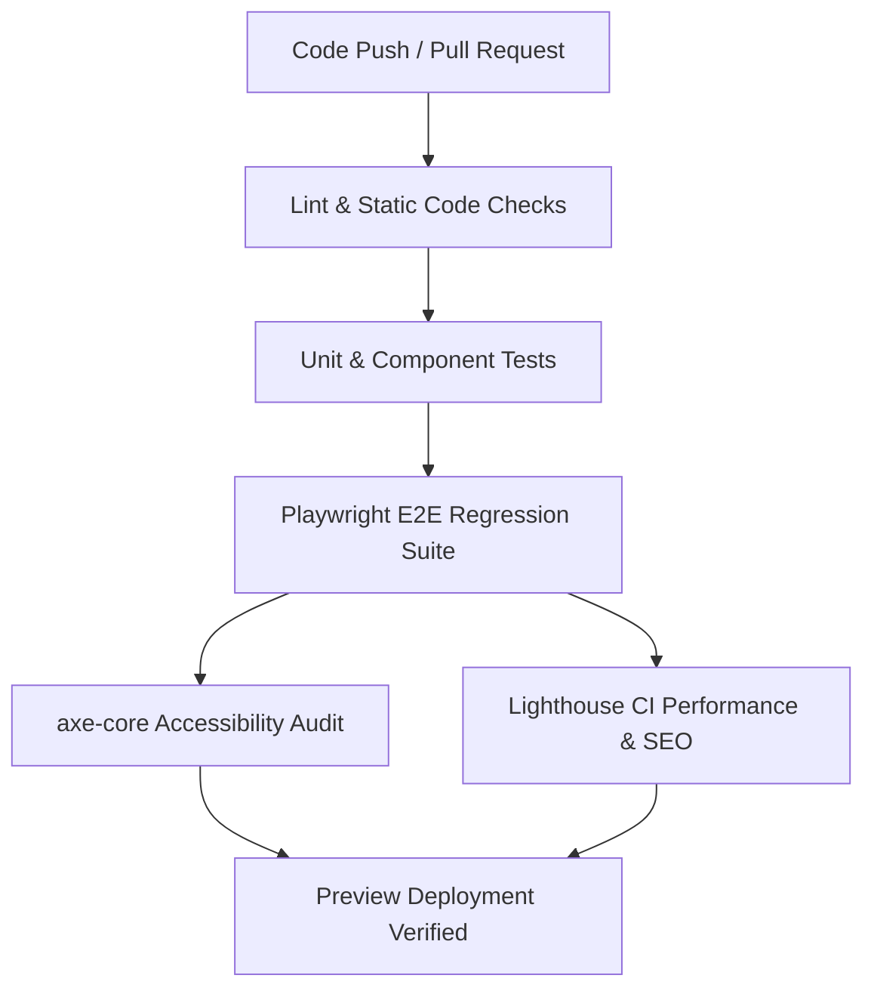

# Cynbit Website — Prioritized Improvement Recommendations

**Target:** [https://www.cynbit.in/](https://www.cynbit.in/) | **Date:** 2 November 2026 | **Author:** Kartik Karnwal  
**Reference Document:** Corresponds directly to verified defects logged in [02-bug-issue-report.md](file:///c:/Users/Kartik/Desktop/TEST/02-bug-issue-report.md).

---

## 1. Prioritized Engineering Action Plan

### Tier 1: P1 — Immediate Release Blockers (Fix within 24-48 Hours)

| # | Priority | Recommended Action | Target Files / Scope | Defect IDs Resolved | Estimated Dev Effort |
|---|:---:|---|---|---|:---:|
| **1** | **P1** | **Implement Real-time Contact Form Validation & State Feedback** Add client-side form validation (React Hook Form / Zod) to `/contact`. Ensure explicit red inline error banners display when required inputs are empty or invalid emails are entered. Add a success toast upon dispatch. | `components/contact/ContactForm.tsx` | CYN-026, CYN-024 | 0.5 Day |
| **2** | **P1** | **Data Minimization on Careers Application Workflow** Remove intrusive mandatory fields (Date of Birth, Gender, WhatsApp number, Permanent Residential Address) from candidate screening. Ensure candidate consent explicitly references the Privacy Policy. | `app/careers/[slug]/page.tsx`, `components/careers/ApplicationWizard.tsx` | CYN-004 | 0.5 Day |
| **3** | **P1** | **Deploy Cookie Consent Opt-in Mechanism** Implement an accessible cookie consent modal or bottom banner that permits users to Accept or Reject Google Analytics tracking prior to cookie initialization, aligning with DPDP and GDPR requirements. | `components/common/CookieConsent.tsx`, `app/layout.tsx` | CYN-005 | 1.0 Day |

---

### Tier 2: P2 — Next Sprint Enhancements (Fix within 1-2 Weeks)

| # | Priority | Recommended Action | Target Files / Scope | Defect IDs Resolved | Estimated Dev Effort |
|---|:---:|---|---|---|:---:|
| **4** | **P2** | **Inject Comprehensive HTTP Security Headers** Configure Next.js response headers in `next.config.js`: enforce `X-Frame-Options: DENY`, `X-Content-Type-Options: nosniff`, `Referrer-Policy: strict-origin-when-cross-origin`, and a hardened `Content-Security-Policy` (CSP). Restrict CORS to trusted origins. | `next.config.js` | CYN-028 | 0.5 Day |
| **5** | **P2** | **Centralize Company Metadata & Correct OpenGraph Protocol** Standardize canonical links and `og:url` to `https://www.cynbit.in/${path}`. Remove duplicated brand strings from page titles. Replace vector SVG `og:image` with high-resolution 1200x630px JPG/PNG preview cards. | `app/layout.tsx`, `app/**/page.tsx` | CYN-008, CYN-009, CYN-010, CYN-011 | 1.0 Day |
| **6** | **P2** | **Single Source of Truth for Contact Channels & Metrics** Create `config/contact.ts` to supply unified phone numbers and emails to both the Footer and `/contact`. Reconcile conflicting company metrics (99.99% vs 99.9% uptime; 100+ projects vs 13 case studies) into verified marketing benchmarks. | `config/contact.ts`, `components/Footer.tsx`, `app/case-studies/page.tsx` | CYN-003, CYN-012 | 0.5 Day |
| **7** | **P2** | **Accessibility Fix for Icon Ligatures & Keyboard Navigation** Add `aria-hidden="true"` to all Material Symbols icon tags so names like `east` or `expand_more` do not pollute screen readers. Provide a hidden skip-to-content anchor (`<a href="#main" className="sr-only focus:not-sr-only">`) at the top of the layout. | `components/ui/Icon.tsx`, `app/layout.tsx` | CYN-017, CYN-027 | 0.5 Day |
| **8** | **P2** | **Self-Host Media & Eliminate Placeholder Services** Replace `i.pravatar.cc` avatars on `/bitelevate/paths` and Unsplash hotlinked photography with optimized WebP/AVIF images hosted locally in `/public/images/`. Adjust `next/image` sizes attributes to prevent `w=3840` requests for small avatars. | `app/bitelevate/paths/page.tsx`, `components/TeamMember.tsx` | CYN-014, CYN-015 | 1.0 Day |
| **9** | **P2** | **Connect Inert CTA Buttons to Real User Journeys** Ensure buttons on `/services` ("Inquire", "Start discovery", "Roadmap") and `/products` ("Start Building Legacy", "Schedule Tour") link directly to demo schedules, sign-in endpoints, or functional contact anchors. | `app/services/page.tsx`, `app/products/page.tsx` | CYN-019, CYN-020 | 0.5 Day |

---

### Tier 3: P3 — Polish & Technical Debt Backlog

| # | Priority | Recommended Action | Defect IDs Resolved | Estimated Dev Effort |
|---|:---:|---|---|:---:|
| **10** | **P3** | **Fix Typos and Brand Copy Errors** Correct "Unheared Stories" to "Unheard Stories" on `/diaries`; correct "Lead by" to "Led by" on `/team`; adjust punctuation on `/services` H1. | CYN-006, CYN-007 | 2 Hours |
| **11** | **P3** | **Harmonize Blog Taxonomy & Query Route Routing** Either implement pagination controls on `/blog` or remove stale pagination logic. Ensure category filter pills match post tag taxonomy. | CYN-001, CYN-023 | 0.5 Day |
| **12** | **P3** | **Correct Semantic Heading Hierarchies** Convert descriptive paragraphs incorrectly tagged as `<h2>` on `/bitelevate/paths` into standard `
` elements. | CYN-018 | 1 Hour |
| **13** | **P3** | **Fix Mismatched Founder/CTO Bios & Narrative Chronology** Swap the CTO and Co-Founder bios on `/team` to reflect accurate responsibilities; adjust timeline narrative on `/story` to avoid 2024 &rarr; 2022 jumps. | CYN-016, CYN-025 | 2 Hours |
| **14** | **P3** | **Update Date Formats & Fix Contact Redirection on Portfolio CTA** Change ambiguous "Apr 26" dates to "26 April 2026". Update "Drop a portfolio" CTA to provide a direct upload or link field. | CYN-021, CYN-022 | 2 Hours |

---

## 2. QA Quality Assurance & Automation Strategy

To prevent visual, functional, and security regressions on Cynbit production deployments, the following automated testing pipelines should be added to the CI/CD pipeline (e.g., GitHub Actions):

### 2.1 Recommended Automated Test Stack

1. **End-to-End Functional Suite (Playwright):**
   * Automated contact form submission with positive and negative inputs.
   * Multi-step careers form execution and resume upload simulation.
   * Responsive navigation drawer verification across mobile (360px), tablet (768px), and desktop (1280px).
   * Blog category filter query verification.
2. **Automated Accessibility Testing (`@axe-core/playwright`):**
   * Automated scans in CI to ensure zero WCAG 2.1 AA violations on color contrast, missing alt attributes, heading nesting, and icon text pollution.
3. **Automated Security & Header Linting:**
   * Scripted HTTP check to assert presence of `Content-Security-Policy`, `X-Frame-Options`, and `X-Content-Type-Options` on staging and production deployments.
4. **Lighthouse CI (LHCI):**
   * Enforce Performance &gt; 90, Accessibility &gt; 95, Best Practices &gt; 95, and SEO &gt; 95 budgets.

---

## 3. Engineering Implementation Roadmap

* **Sprint 1 (Week 1):** Execute Tier 1 P1 hotfixes (Contact form validation, Career form PII minimization, Cookie banner) + quick copy typos.
* **Sprint 2 (Week 2):** Implement Tier 2 P2 architecture items (Security headers in `next.config.js`, Metadata/OpenGraph canonicalization, Single source of truth for contact details).
* **Sprint 3 (Week 3):** Media optimization, Accessibility enhancements (icon `aria-hidden` and skip links), and Playwright E2E test suite integration into GitHub Actions.
